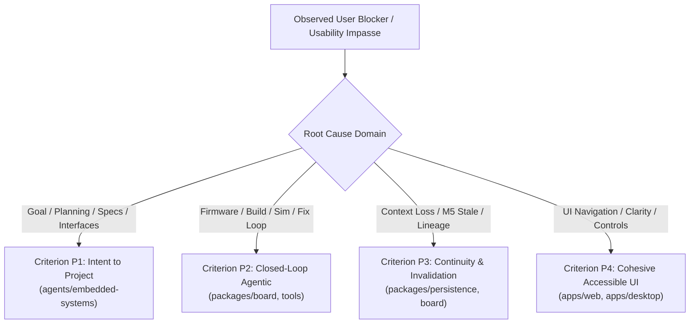

# Nexus Product MVP — External-User Evaluation Protocol (P5)

Status: Approved by Pranay (2026-10-23) as the W9/W10 evaluation framework, with the refinements below incorporated. Part of the approved P5 roadmap.

> [!IMPORTANT]
> **Scope & Gating**: This approval does **not** authorize participant sessions before the W8 gate (usable golden workflow) is reached and verified, and does not expand scope beyond Product MVP criteria P1–P5. Recruitment and contact with participants remain exclusively Pranay's responsibility.
Approved Reference: [Nexus Product MVP Contract](./NEXUS_PRODUCT_MVP_CONTRACT.md), [Implementation Plan (W9/W10)](./NEXUS_PRODUCT_MVP_IMPLEMENTATION_PLAN.md), [Gap Analysis](./NEXUS_PRODUCT_MVP_GAP_ANALYSIS.md).
Governing Principle: Real-world empirical observation of external target users attempting the golden workflow. Internal sign-off, developer demonstrations, scripted personas, and automated tests cannot substitute for P5 validation.

---

## 1. Target-Participant Qualification & Exclusion Criteria

To validate Criterion P5 honestly, evaluation participants must represent the authentic target audience for Nexus (“Cursor for engineering”) within the embedded robotics vertical.

### 1.1 Target Participant Cohorts
A minimum of three (≥3) distinct external participants must be recruited across one or more of the four core contract personas:
1. **Engineering Students**: Undergraduate or graduate students in electrical, computer, mechatronics, or robotics engineering with hands-on microcontroller project experience.
2. **Independent Engineers**: Independent consultants, embedded firmware engineers, or hardware enthusiasts building real-world microcontroller/sensor solutions.
3. **Applied Researchers**: Academic or laboratory researchers prototyping experimental robotics or sensor acquisition rigs.
4. **Early Hardware/Robotics Founders**: Technical founders, CTOs, or founding engineers at early-stage hardware or robotics startups.

### 1.2 Mandatory Qualification Requirements
Participants must possess baseline domain competency so the session evaluates Nexus rather than teaching basic engineering concepts:
- **Embedded Competency**: Practical familiarity with C/C++ or Arduino/ESP-IDF development, basic GPIO/peripheral pinouts, and standard serial/I2C communication.
- **Physical/Sensor Concepts**: Basic understanding of sensor data streams, coordinate axes, and noise filtering/metrics (e.g., stationary RMS acceleration).
- **Tooling Comfort**: Ability to operate an interactive desktop or browser-based IDE/workspace on a standard laptop.

### 1.3 Exclusion Rules
General prior awareness of Nexus (e.g., having heard of the product, read public descriptions, or seen general marketing/overview material) does **not** disqualify a participant. To ensure unbiased evidence, the following do:
- **No Development Involvement**: No current or former contributors, core team members, or contract developers of the Nexus repository, and no one otherwise involved in building Nexus.
- **No Golden-Workflow Coaching**: Anyone who has been walked through, demonstrated, or coached on the ESP32 + MPU6050 golden workflow (internal walkthroughs, demos, screen shares, or briefings of that workflow) is excluded.
- **No Exposure to the Injected Failure**: Anyone who has seen or had access to the injected failure definition, its symptoms, or its fix (including via Nexus test harnesses or golden fixtures) is excluded.
- **No Coached Facilitation**: Participants must not be prompted with answers or guided through the sequence.

### 1.4 Transparent Recording of Prior Exposure
Each session record must state the participant's prior exposure to Nexus (none / general awareness / other, with a short description) so readers can judge any bias. Prior exposure is reported in the sanitized W10 aggregate.

---

## 2. Environment Prerequisites (Gates) & Golden Task Script

External evaluation requires a real, functional product path. If prerequisites fail or are mocked, the session is invalid as P5 evidence.

### 2.1 Environmental & Toolchain Gates (Pre-Session Checklist)
Before admitting an external participant to the task, the session facilitator must verify all technical gates on the evaluation workstation:
1. **Model Provider Gate**: Valid API credentials configured for the live model provider (e.g., Anthropic Claude / OpenAI); live generation mode enabled (`NEXUS_MODEL_GATEWAY_MODE=live`); fake/stub gateways disabled.
2. **PlatformIO Toolchain Gate**: Local `platformio` CLI (`pio`) installed, functional, and verified; `espressif32` platform and toolchain packages cached and operational; firmware compile stub disabled (`NEXUS_FIRMWARE_USE_STUB=0`).
3. **Circuit Simulation Gate**: `wokwi-cli` installed and in system `PATH`; valid, non-expired `WOKWI_CLI_TOKEN` active with sufficient entitlement; surrogate translation and simulation runner operational.
4. **Python Analysis Gate**: Host Python analysis environment configured with necessary numerical/data libraries (`numpy`, `scipy`, `matplotlib`); analysis stub disabled (`NEXUS_ANALYSIS_USE_STUB=0`).
5. **Product UI & Storage Gate**: Nexus product UI (web or desktop) running against the real authenticated API backed by durable SQLite and local file storage; developer bypasses and direct database manipulation prohibited.

> [!IMPORTANT]
> **Honesty Gate**: If any prerequisite is unavailable (e.g., missing PlatformIO or exhausted Wokwi quota), the UI must honestly surface tool unavailability per P4. Stubs, simulated compiles, or pre-canned CSV outputs must NEVER be silently swapped in to fabricate a passing session.

### 2.2 Golden Workflow Task Script (Non-Leading)
The facilitator introduces the system neutrally without prescribing user actions or pointing out interface elements.

#### Facilitator Introductory Script
> *"Welcome, and thank you for taking part in this evaluation of Nexus. Nexus is an interactive workspace designed to help engineers turn goals into verified hardware and firmware projects. Today, we ask you to use Nexus to achieve an embedded engineering objective.*
> 
> *Please think out loud as you work: mention what you expect to see, what confuses you, and why you choose to take specific actions. I will observe and take notes. Because we are testing the software and not your abilities, I cannot tell you what buttons to click or how to navigate the system, but I can assist if you encounter a software crash.*
> 
> *Here is your engineering objective."*

#### Participant Task Card
```text
Task Objective: ESP32 + MPU6050 Vibration Monitor

Goal:
Build and verify an embedded vibration monitor using an ESP32 microcontroller and an MPU6050 IMU sensor.

Requirements:
1. Connect the ESP32 and MPU6050 over I2C.
2. Author firmware to stream acceleration telemetry over serial at 115200 baud.
3. Build the firmware and simulate the circuit to capture telemetry observations.
4. Run analysis on stationary sensor noise to verify that X-axis RMS acceleration noise remains below 0.10 g
   (RMS of X-axis acceleration after subtracting the stationary mean, in g).
5. Inspect any detected issues, review any proposed fixes, and verify the final system state in the product UI.
```

#### 2.3 Stationary Noise Metric Definition
The pass criterion in task step 4 is defined precisely as:

$$\text{RMS}_x = \sqrt{\frac{1}{N}\sum_{i=1}^{N}\left(a_{x,i} - \bar{a}_x\right)^2}, \qquad \bar{a}_x = \frac{1}{N}\sum_{i=1}^{N} a_{x,i}$$

- $a_{x,i}$ is the X-axis acceleration sample in **g** (converted from raw MPU6050 counts using the configured full-scale range, e.g. 16384 LSB/g at ±2 g).
- Subtracting the stationary mean removes static offset/gravity projection, so the metric measures noise only (equivalent to the population standard deviation). Units: **g**. Pass: $\text{RMS}_x < 0.10$ g.
- **Observation & sampling assumptions must be fixed and recorded before any testing begins** (W8 gate checklist), and must not be tuned after observing results:
  - Sampling rate (proposed default: 100 Hz).
  - Observation duration of the stationary window (proposed default: 10 s, excluding any start-up/settling period, proposed 1 s).
  - Resulting sample count N (proposed default: N = 1000; minimum acceptable N must be stated alongside).
  - Accelerometer full-scale range and conversion factor.
- Final values are recorded in the session record (Section 3 of the template). The defaults above are proposals until confirmed at the W8 gate.

#### Facilitator Operating Boundaries
- The facilitator must remain silent during normal operation.
- Do not point to buttons (e.g., do not say "Click Approve Proposal" or "Go to the Evidence Explorer").
- Do not explain why a build or test failed while the participant is inspecting it.
- If the participant asks "What do I do next?", respond with a non-leading probe: *"What does the workspace currently indicate?"* or *"What would you normally do at this stage in an IDE?"*

### 2.4 Session Modalities
Both moderated and appropriately instrumented unmoderated sessions are permitted, provided the following can be assessed reliably:
- **Moderated** (remote or in-person): facilitator observes live, follows the non-leading boundaries above, and logs assistance per Section 3.
- **Instrumented Unmoderated**: allowed only if the session captures enough evidence to assess (a) actual workflow completion per step, from real product event/execution logs; (b) any assistance received (in an unmoderated session, help requests and any external help must be self-reported and logged, and a built-in "I'm stuck" mechanism or equivalent must exist); (c) blockers, via timestamped product logs plus think-aloud or post-step notes; and (d) comprehension, via the Section 6 comprehension questions answered in writing or a short follow-up interview.
- If any of (a)–(d) cannot be assessed reliably for a session, that session is reported as inconclusive and is not counted as P5 evidence.

---

## 3. Assistance Taxonomy & Reporting Policy

To ensure that usability friction and agent autonomy are measured accurately, any assistance provided during the session must be classified and reported.

### 3.1 Taxonomy of Assistance

| Level | Classification | Definition | Example |
| :--- | :--- | :--- | :--- |
| **L0** | **None (Autonomous)** | Participant executes the step entirely independently without any facilitator input. | User reads the execution plan, identifies the review control, and approves the workspace without prompting. |
| **L1** | **Hint** | Facilitator provides a high-level conceptual or orientation nudge after the participant has been blocked or disoriented for >2 minutes. No specific action is instructed. | *"Nexus requires explicit user approval before workspace files can be modified."* or *"Status indicators are displayed in the project banner."* |
| **L2** | **Intervention** | Facilitator provides explicit procedural guidance directing the participant to a specific control or action to bypass interface friction. | *"Click the 'Review Diff' button in the top right corner of the firmware workspace to review the agent's patch."* |
| **L3** | **Facilitator-Performed Step** | Facilitator takes over keyboard/mouse to execute a step or perform a technical workaround due to an environment hang, UI lockup, or fatal usability impasse. | Facilitator manually restarts the local dev server or recovers a frozen UI view. |

### 3.2 Reporting Assisted Completion
- A step completed with **L0 (None)** is recorded as **Autonomous Completion**.
- A step requiring **L1 (Hint)** is recorded as **Autonomous with Hint**.
- Any step requiring **L2 (Intervention)** or **L3 (Facilitator-Performed Step)** is strictly recorded as **Assisted Completion** and CANNOT be counted as autonomous product validation.
- In the final W10 aggregate report, session completions must be reported transparently:
  $$\text{Autonomous Full Completion} \quad \text{vs.} \quad \text{Assisted Completion} \quad \text{vs.} \quad \text{Abandoned / Blocked}$$
- Every L1–L3 event must cite the exact workflow step, the trigger, and the facilitator's verbatim prompt.

---

## 4. Per-Session Record Template

Every evaluation session must produce a completed record following this exact markdown template:

```markdown
# Nexus External Evaluation Session Record

## 1. Session Metadata
- **Session Identifier**: EXT-USER-[001/002/003/...]
- **Evaluation Date**: YYYY-MM-DD
- **Facilitator Name**: [Name]
- **Session Modality**: [Remote Moderated / In-Person Moderated / Instrumented Unmoderated]
- **Recording Consent**: [Audio/Video recording consented: Yes/No — if No, evidence is anonymized observation notes]
- **Session Duration**: [Total Minutes]

## 2. Participant Qualification Profile
- **Target Persona Category**: [Student / Independent Engineer / Researcher / Early Founder]
- **Current Role & Domain**: [e.g., Graduate Mechatronics Student / Robotics Startup CTO]
- **Embedded / C++ Experience**: [e.g., 3 years Arduino & ESP-IDF; frequent I2C sensor use]
- **Verification / Analysis Familiarity**: [e.g., Uses Python/NumPy for IMU data analysis]
- **Confirmation of Exclusions**:
  - [ ] No prior involvement with Nexus repository or development team.
  - [ ] No prior demonstrations, coaching, or walkthroughs received.
  - [ ] No exposure to the injected failure, golden test fixtures, or their fix.
- **Prior Nexus Exposure (record transparently)**: [None / General awareness — describe source / Other — describe]

## 3. Environment & Technical Verification
- **Workstation OS & Architecture**: [e.g., Ubuntu 22.04 LTS x86_64 / macOS 14.2 ARM64]
- **Display Resolution & Scale**: [e.g., 1920x1080 @ 100%]
- **Nexus Commit Hash**: [git rev-parse HEAD]
- **Model Gateway Provider & Model**: [e.g., Anthropic claude-3-5-sonnet] (Live mode confirmed: Yes/No)
- **PlatformIO Version**: [e.g., pio 6.1.15] (Firmware stub disabled: Yes/No)
- **Wokwi CLI Version**: [e.g., wokwi-cli 0.1.19] (Token verified: Yes/No)
- **Host Python Version**: [e.g., Python 3.11.8] (Analysis stub disabled: Yes/No)
- **Noise Metric Parameters (fixed before testing)**: [Sampling rate Hz / Window duration s / Settling s / Sample count N / Full-scale range]

## 4. Workflow Progression & Assistance Log

| Step # | Golden Workflow Step | Status (Completed / Blocked / Abandoned) | Assistance Level (L0 / L1 / L2 / L3) | Elapsed Time (min) | Notes & Observations |
| :--- | :--- | :--- | :--- | :--- | :--- |
| 1 | Goal Entry & Intent Description | | | | |
| 2 | Plan, Requirements & Assumption Review | | | | |
| 3 | Workspaces & Component Initialization | | | | |
| 4 | Agent Firmware Authoring & Review | | | | |
| 5 | Real PlatformIO Build Execution | | | | |
| 6 | Circuit Sim Execution & Data Observation | | | | |
| 7 | Injected Failure Detection & Inspection | | | | |
| 8 | Agent Repair Proposal, Approval & Rerun | | | | |
| 9 | Input Revision & M5 Invalidation Inspection | | | | |
| 10 | Evidence Explorer & Limitations Inspection | | | | |

## 5. Detailed Assistance & Intervention Events
*(Record every L1, L2, or L3 assistance event)*
- **Event 1 (Step X)**:
  - *Trigger/Blocker*: [What stalled the user?]
  - *Facilitator Action*: [Exact hint or intervention given]
  - *User Reaction*: [Did the user understand and regain control?]

## 6. Participant Conceptual Comprehension Checks
*(Facilitator asks participant to explain these key concepts at session conclusion)*
1. **Explanation of Injected Failure**:
   - *Question*: "Can you explain what failed during the workflow and why?"
   - *Participant Response Summary*: [Record verbal explanation]
   - *Comprehension Assessment*: [Accurate / Partially Accurate / Inaccurate / Not Understood]
2. **Understanding of Current Applicability vs. Historical Evidence (M5 Invalidation)**:
   - *Question*: "When the design input was modified, what happened to the previous test results and why?"
   - *Participant Response Summary*: [Record verbal explanation]
   - *Comprehension Assessment*: [Accurate / Partially Accurate / Inaccurate / Not Understood]
3. **Understanding of Simulator Surrogate Limits**:
   - *Question*: "Does passing the simulation prove that this physical circuit and sensor will work on real hardware?"
   - *Participant Response Summary*: [Record verbal explanation]
   - *Comprehension Assessment*: [Understood surrogate limit / Mistook simulation for physical proof]

## 7. Observed Failures, Bugs & Ergonomic Friction
- **System / Tool Bugs**: [List any application crashes, unhandled errors, or CLI failures]
- **Agent Failures**: [List any hallucinated files, incorrect patches, or runaway loops]
- **UI / UX Friction**: [List layout overflows, confusing labels, unresponsiveness, or unclear status]

## 8. Qualitative Participant Feedback
- *What felt intuitive?*:
- *What felt confusing, frustrating, or untrustworthy?*:
- *Verbatim notable quotes*:
```

---

## 5. Consent & Private-Data Handling (Outside Git)

Strict compliance with privacy, participant rights, and monorepo security policies is mandatory.

### 5.1 Informed Participant Consent
Prior to starting an evaluation session, each participant must review and sign an evaluation consent agreement covering:
- **Purpose**: Observation of engineering workflows to improve developer tooling.
- **Consent to Participate (required)**: Agreement to take part, have observation notes taken, and have product-generated execution logs and interaction timestamps captured.
- **Consent to Audio/Video Recording (separate and optional)**: Recording of audio, video, and/or screen is requested separately. A participant who declines recording may still participate; in that case anonymized observation notes (plus product logs) serve as the session evidence. Declining recording has no effect on eligibility.
- **Voluntary Participation**: Unconditional right to pause, take breaks, or terminate the session at any moment without providing a reason.
- **Confidentiality**: Explicit guarantee that the participant’s name, personal details, employer/institution, and unredacted recordings will never be made public or committed to a public repository.

### 5.2 Storage of Raw Session Material (Strictly Outside Git)
Under [AGENTS.md Section 12](../../AGENTS.md#12-generated-artifacts-policy) and [Section 13](../../AGENTS.md#13-security-policy), raw session artifacts, recordings, and personal data must NEVER be committed to the Git repository.
- **Prohibited in Git**: Video/audio screen recordings (`.mp4`, `.mkv`), raw audio transcripts, signed consent forms containing real names/signatures, raw shell histories containing local machine paths or usernames, and API credential traces.
- **Designated Off-Git Storage**: All raw materials must be stored in a designated, access-controlled secure storage location (e.g., an encrypted directory or secure drive designated by Pranay).
- **Retention Schedule**: Raw media files are retained strictly for the duration of the MVP evaluation and triage cycle, after which they are archived or deleted according to data protection agreements.

### 5.3 Sanitized Aggregate Reporting
Only anonymized, sanitized summaries may be checked into documentation or PR review packets:
- Use consistent anonymized keys (`EXT-USER-001`, `EXT-USER-002`, `EXT-USER-003`).
- Generalize personal background (e.g., "Graduate Student in Mechatronics at a US university" or "Robotics Startup Founder").
- Sanitize file paths, environment variables, and any participant organization details.
- Scrub any incidental personal data from qualitative quotes.

---

## 6. W10 Triage Procedure: Mapping Blockers to P1–P4 Criteria

The transition from W9 (Evaluation Execution) to W10 (Triage and Review) requires systematic mapping of observed user blockers into concrete product remediation tasks.

### 6.1 Blocker Extraction & Evidence Linking
Every failure, abandonment, confusion event, or L2/L3 intervention recorded during external sessions must be logged as a discrete blocker issue and linked to its exact timestamped evidence in the session log.

### 6.2 Mapping to Product Criteria (P1–P4)
Each blocker must be assigned to exactly one owning criterion and owning module:



1. **Criterion P1 (Intent to Executable Project)**:
   - Ambiguous or poorly structured initial requirements generated from the goal.
   - User unable to review, edit, or reject proposed component plans or interface bindings.
   - Failure of the project to initialize an actionable, consistent workspace.
2. **Criterion P2 (Closed-Loop Agentic Engineering)**:
   - Agent generates uncompilable C++ code or broken PlatformIO configuration.
   - Injected failure not detected or misdiagnosed from actual tool outputs.
   - Agent repair generates nonsensical or un-reviewable diffs; failure to rerun affected tools.
   - Retries become un-cancellable or run into unmanaged infinite loops.
3. **Criterion P3 (Cross-Tool Context Continuity & M5 Invalidation)**:
   - Breakage in lineage between requirement, firmware build, and simulation output.
   - Modifying an upstream design parameter fails to automatically mark affected downstream results as `STALE` or `RECHECK_REQUIRED`.
   - Invalidation reasons are missing or do not explain the triggering dependency.
   - System permits historical PASS to be misrepresented as valid for modified inputs.
4. **Criterion P4 (Accessible, Cohesive UI Workflow)**:
   - User cannot locate primary controls (e.g., approve plan, review diff, run build, cancel).
   - Ineffective state surfacing (e.g., user cannot tell whether build is running, pending, or failed).
   - Viewport layout breakdown, truncated logs, or missing keyboard accessibility.
   - Missing or opaque explanations for why an artifact is stale.

### 6.3 Triage Matrix Structure for W10 Review
The deliverable for W10 will format all blockers into an executive triage matrix:

| Blocker ID | Criterion | Owning Module | Description & User Impact | Session Evidence Reference | Remediation Task / Package |
| :--- | :--- | :--- | :--- | :--- | :--- |
| BLK-01 | P4 | `apps/web` | Participant unable to find proposal approval button after firmware fix. | EXT-USER-001 (Step 8, min 24:12) | Adjust action bar prominence and add keyboard shortcut. |
| BLK-02 | P2 | `packages/board` | PlatformIO build diagnostic output truncated, obscuring compiler syntax error. | EXT-USER-002 (Step 5, min 14:05) | Pipe complete stderr stream into execution log viewer. |
| BLK-03 | P3 | `nexus_board/services`| Invalidation reason displayed as raw JSON key rather than human-readable dependency. | EXT-USER-003 (Step 9, min 38:50) | Integrate #109 human-readable reason formatter in UI. |

---

## 7. Integrity & Gate Statements

### 7.0 Preserved Non-Negotiable Requirements
The approved refinements do not relax any of the following:
- **Real providers**: live model provider; no fake/stub gateways.
- **Real execution**: real PlatformIO builds, real Wokwi simulation, and real analysis; no stubs or pre-canned outputs.
- **Honest limitations**: tool unavailability and simulator-surrogate limits are surfaced truthfully.
- **External users**: real external target participants only. **No mocked, scripted, or persona-driven sessions** may be substituted, in either modality.
- **Gating**: no participant sessions before the W8 gate; no expansion beyond P1–P5.

### 7.1 No Invented Pass Thresholds
Under the approved direction (October 22, 2026), no artificial satisfaction threshold (e.g., "80% CSAT", "3 out of 3 users must finish in under 30 minutes") has been established, and none may be invented by engineering agents.
- Outright success, assisted completions, usability deadlocks, and task abandonments must be reported with 100% empirical honesty.
- Presenting an unvarnished factual accounting of where external users succeeded and where they got stuck is the sole requirement for P5 evidence.

### 7.2 Non-Substitutability of Internal Sign-off
- Internal dogfooding, team-member trials, and automated browser end-to-end scripts (such as Playwright suites) are valuable regression tests, but they **cannot substitute** for external user validation.
- P5 acceptance is strictly contingent on observing external target participants executing the product path and reviewing the resulting evidence with Pranay.

---

## 8. Open Decisions Reserved Exclusively for Pranay

In strict accordance with the approved direction:
> *"P5 (external user evaluation) needs Pranay to recruit/contact users — never contact anyone ourselves."*

The following governance and logistical decisions can only be made by Pranay:
1. **Recruitment Channels & Outreach**: Which communities, university departments, or founder networks to contact (e.g., university robotics labs, hardware accelerator cohorts, embedded developer forums).
2. **Participant Compensation & Honorarium**: Whether participants receive financial compensation, gift cards, Nexus platform credits, or participate on a voluntary basis.
3. **Session Modality & Coordination**: Which of the permitted modalities (Section 2.4: moderated remote/in-person, or instrumented unmoderated) to use per participant, and the scheduling tools.
4. **Workstation Environment Provisioning**: Whether participants will be provided with a pre-configured cloud VM / desktop environment accessible via browser, or if participants will clone and run Nexus locally on their personal hardware.
5. **Secure Off-Git Storage Designate**: Designation of the exact cloud storage location or encrypted drive for storing raw participant video recordings, audio transcripts, and signed consent forms.
6. **Execution Schedule**: Establishing the calendar dates for participant sessions once Work Package W8 (UI integration gate) is completed and verified.
7. **P5 Final Sign-Off**: Formal determination of whether the observed results and W10 triage plan satisfy the product MVP exit criteria.
